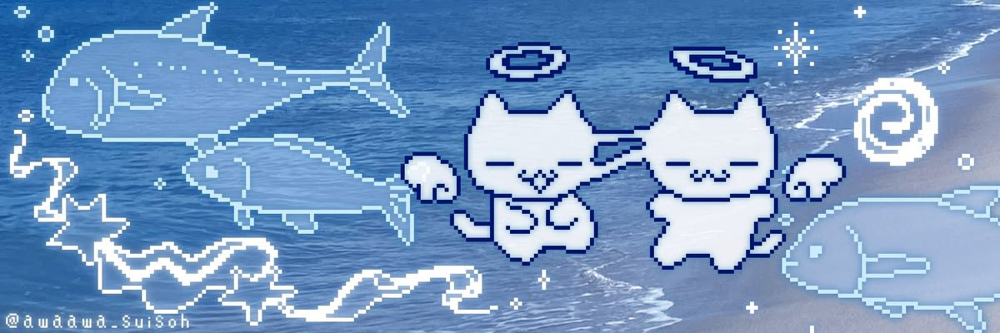

  
  banner art by <a href="https://www.instagram.com/awaawa_suisoh/">@awaawa_suisoh</a> 🐟

<h1 align="center">˚₊‧ Kat was here :) ‧₊˚</h1>

<i>ITC student @ Tec de Monterrey</i>

  

  <i>"I think engineering and code are creative fields at heart. 
  Every robot, website, and line of code started as something someone imagined."</i> 
  🫧

<h3>🐚 Fun facts about me</h3>
<ul>
  <li>🌊 I live between <b>Monterrey, Mexico</b> 🇲🇽 and <b>Dallas, USA</b> 🇺🇸</li>
  <li>🐱 My cats (Boona, Link, Pedro, Zumo) are depending on me to make a career for myself </li>
  <li>🔧 I started in mechatronics before switching to computer science (mechatronics is my ex I never can forget about)</li>
  <li>🎨 I make 3D art in Blender for fun! I also really enjoy pixel art</li>
  <li>🤖 Right now outside of my classes, my life revolves around FrED Factory (Project Manager w/ Tec & MIT), WIT (Software Director), Orbita (Software Lead), and helping out as the Lead of Attendee Operations for the FrED Factory Summit Logistics!</li>
  <li>💙 I'm looking forward to working in the Beta Testing team for <a href="https://www.instagram.com/sagecadence_/">@sagecandace_</a>'s starjam cyberdeck project! I really love the internet trends going on with personalizing tech (hoping to make my own digital hairclip soon!)
    
   <li> <i>Often times you can find me on campus eating maruchan @ the bibliotec terrace ;)</i>
</ul>

<h3>🐟 Currently swimming in</h3>
<pre>
  ><(((°>   learning cybersecurity on TryHackMe
  ><(((°>   learning to rice my os
  ><(((°>   robots, robots, robots
</pre>

<h3>
  
  Monster Energy Vending Machine
</h3>

  <b>Total cans to date:</b>
  

<b>Dispense a Flavor:</b>

  <a href="https://github.com/katuhiel-dev/katuhiel-dev/issues/new?title=add-drink&body=flavor:original">Original</a> ·
  <a href="https://github.com/katuhiel-dev/katuhiel-dev/issues/new?title=add-drink&body=flavor:ultra-zero">Ultra Zero</a> ·
  <a href="https://github.com/katuhiel-dev/katuhiel-dev/issues/new?title=add-drink&body=flavor:electric-blue">Electric Blue</a> ·
  <a href="https://github.com/katuhiel-dev/katuhiel-dev/issues/new?title=add-drink&body=flavor:sunrise">Sunrise</a> ·
  <a href="https://github.com/katuhiel-dev/katuhiel-dev/issues/new?title=add-drink&body=flavor:ultra-black">Ultra Black</a> ·
  <a href="https://github.com/katuhiel-dev/katuhiel-dev/issues/new?title=add-drink&body=flavor:rosa">Rosa</a> ·
  <a href="https://github.com/katuhiel-dev/katuhiel-dev/issues/new?title=add-drink&body=flavor:paradise">Paradise</a>

  <b><i>How many energy drinks can an engineering student have in a week?</i></b> 
  

<h3>🧸 My toolbox</h3>

<b>🐍 Code</b>

<b>🌐 Web</b>

<b>🤖 Robots & hardware</b>

<b>🎨 Art & design</b>

<b>🛠️ Everyday</b>

  <h3>⋆｡˚ Come say hi ˚｡⋆</h3>
  

    

  <h4>Only able to do it all with the support of my fiance, Ily Emilio &lt;3</h4>

  ˚｡⋆🐟⋆｡˚

